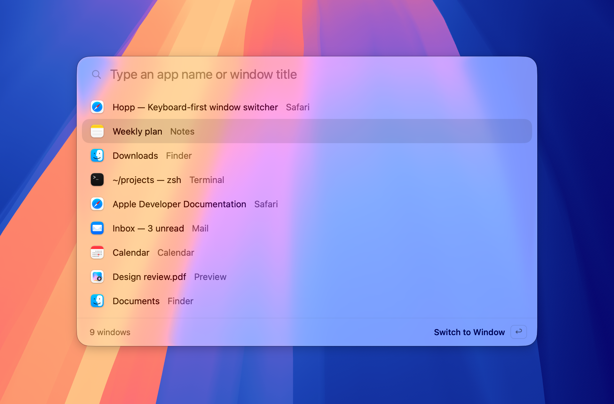

<p align="center">
  
</p>

<h1 align="center">Hopp</h1>

<p align="center">
  <strong>A fast, keyboard-first, native window switcher for macOS. Under 4&nbsp;MB.</strong><br>
</p>

<p align="center">
  <a href="https://github.com/lightly-dev/hopp/releases/latest"><strong>Download for macOS</strong></a>
  &nbsp;·&nbsp; macOS 13 or later &nbsp;·&nbsp; Apple silicon and Intel
</p>

<p align="center">
  
</p>

## Features

- **Window switching** — Navigate every open window with `⌘Tab`, ordered by recent use.
- **Instant search** — Find windows by app name or title, with pinyin（拼音）support.
- **App launcher** — Press `⌥Space` to find and open installed apps.
- **Multi-desktop support** — Switch across Spaces and displays.
- **Fully customizable** — Configure shortcuts, appearance, and window behavior.
- **Native experience** — Built with Swift and AppKit, with Liquid Glass support on macOS 26.

## Why Hopp?

Native. Lightweight. Out of your way.

- Under 4 MB, with support for Apple silicon and Intel.
- Instant launch, minimal resource usage.
- Runs quietly in the menu bar.
- No Electron, bundled browser, or background service.

## Keyboard Shortcuts

| Shortcut               | Action                                |
| ---------------------- | ------------------------------------- |
| `⌘Tab`                 | Switch between windows                |
| `⌘` + `` ` ``          | Switch windows within the current app |
| `⌥Space`               | Open app launcher                     |
| Type                   | Search windows                        |
| `Shift` / `↑` / `↓`    | Navigate                              |
| `↩` / Release modifier | Select window                         |
| `Esc`                  | Dismiss                               |

All shortcuts are customizable.

## Installation

1. Download the latest version from [GitHub Releases](https://github.com/lightly-dev/hopp/releases/latest).
2. Drag **Hopp.app** into Applications.
3. Grant **Accessibility** permission when prompted.

## Build from Source

Requires macOS 13+ and Swift 5.9. Xcode 26 is required to build the app icon.

```bash
swift test
SIGNING_MODE=adhoc ./scripts/build-app.sh
./scripts/build-dmg.sh
```

---

**Hopp** — Every window, one shortcut.

## License

See [LICENSE](LICENSE).
