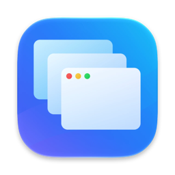
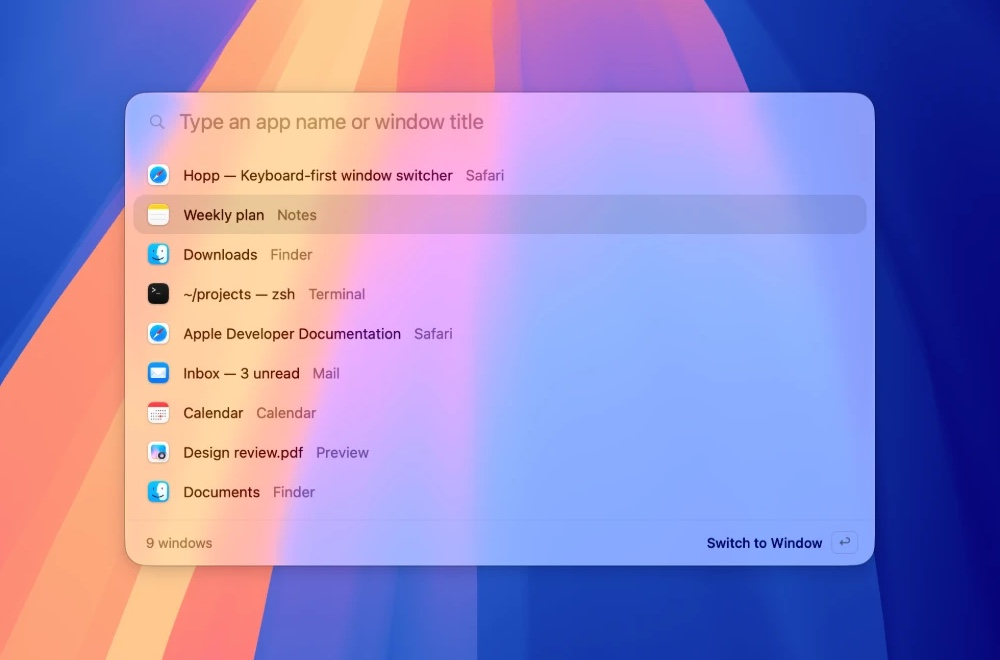

<p align="center">
  
</p>

<h1 align="center">Hopp</h1>

<p align="center">
  <strong>Jump to any window, not just any app.</strong><br>
  A keyboard-first window switcher and app launcher for macOS. Under 4&nbsp;MB.
</p>

<p align="center">
  <a href="https://github.com/lightly-dev/hopp/releases/latest"><strong>Download for macOS</strong></a>
  &nbsp;·&nbsp; macOS 13 or later &nbsp;·&nbsp; Apple silicon and Intel
</p>

<p align="center">
  
</p>

## Why Hopp

The built-in `⌘Tab` switches between apps. When you have three Safari windows and two Finder windows open, you still have to hunt for the right one. Hopp lists every window on its own, in the order you last used them, so the window you want is one keystroke away.

- **Every window, one list.** Windows appear individually with their titles, most recently used first. Minimized and hidden windows come back when you pick them.
- **Type to find.** Keep holding the modifier and type part of an app name or window title. Matches are highlighted, and pinyin works for Chinese names (`weixin` finds 微信).
- **Launch apps too.** `⌥Space` opens a search box for every installed app. Pick one to open it, or bring it forward if it's already running.
- **Built for the keyboard.** Release the modifier to switch, `Shift` to go backward, `Esc` to cancel. The global shortcuts can all be changed.
- **Feels native.** Liquid Glass on macOS 26, light and dark themes, and a quiet menu bar icon. No Dock icon, no windows in your way.

## Lightweight by design

Hopp is a native Swift and AppKit app. There's no Electron, no bundled browser engine and no background service.

- **Under 4 MB to download**, as one universal build for Apple silicon and Intel.
- **Opens instantly.** App icons are prepared in the background, so the launcher shows up without a pause.
- **Runs quietly** from the menu bar, using the Accessibility API only to list and focus windows.
- **Signed and notarized** by Apple, so it opens without security warnings.

## Shortcuts

| Shortcut | Action |
| --- | --- |
| `⌘Tab` | Switch between all windows |
| ``⌘` `` | Switch between windows of the current app |
| `⌥Space` | Open the app launcher |
| Type while holding the modifier | Search by app name or window title |
| `Shift`, `↑` / `↓` | Move backward, or move the selection |
| Release the modifier, or `↩` | Switch to the selected window |
| `Esc` | Close without switching |

All three shortcuts can be changed in Settings.

## More options

- **All desktops:** show windows from every desktop, grouped by desktop with the current one first.
- **Multiple displays:** the switcher opens on the display under the pointer and can list only that display's windows.
- **Keep open:** keep the switcher open after you release the modifier, then type freely. `↩` switches, and `Esc` or a click outside closes it.
- **Theme and language:** follow the system, or pick light or dark. Hopp is available in English, 简体中文, 日本語, Español and Français.

## Install

1. Download the latest DMG from [Releases](https://github.com/lightly-dev/hopp/releases/latest) and drag Hopp to Applications.
2. Open Hopp. It lives in the menu bar.
3. When asked, allow Hopp in System Settings → Privacy & Security → Accessibility. Hopp needs this to see and switch windows and to handle its shortcuts.

## Build from source

Requires macOS 13 or later and Swift 5.9. Building the app icon needs Xcode 26.

```bash
swift test
SIGNING_MODE=adhoc ./scripts/build-app.sh   # local build, no certificate needed
./scripts/build-dmg.sh                      # package dist/Hopp.app into a DMG
```

## License

See [LICENSE](LICENSE).
